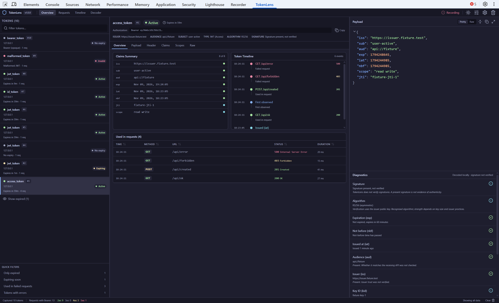
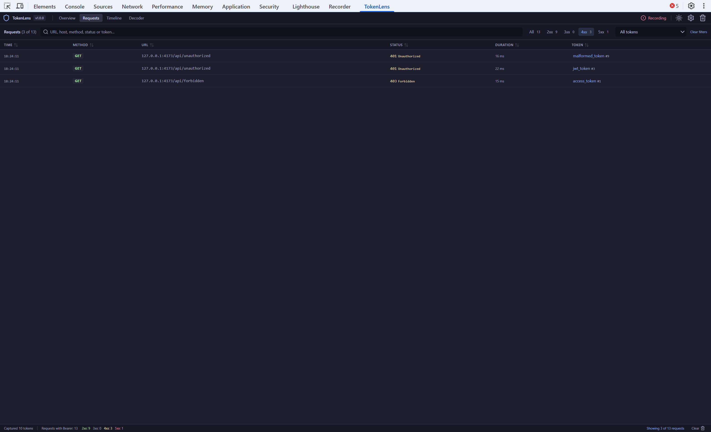
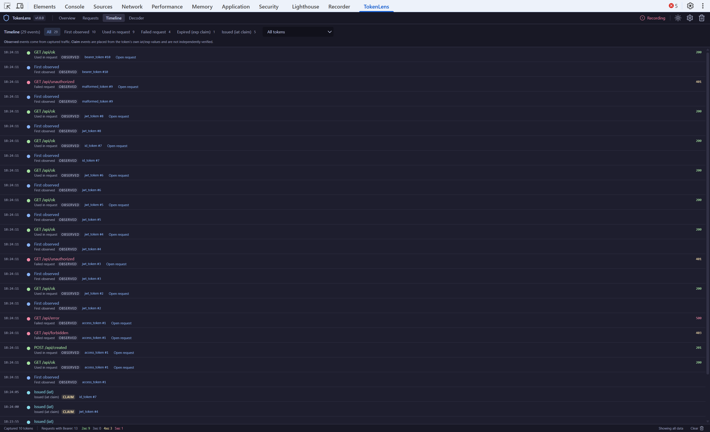

# TokenLens

TokenLens is a Chrome DevTools extension for inspecting JWT and Bearer tokens. It adds a
**TokenLens** tab to DevTools that observes the inspected page's network traffic while DevTools is
open, extracts `Authorization: Bearer` credentials, decodes JWTs locally, correlates each token with
the requests that carried it, and runs temporal diagnostics. Nothing leaves the browser.




## Features

- **Capture** of observed network requests that carry an `Authorization: Bearer` header while
  Chrome DevTools is open. Observation starts when DevTools opens, not when the TokenLens tab is
  first shown, and covers what the DevTools network API reports (see *Known limitations*).
- **Decoding** of JWTs (Base64URL, UTF-8, nested claims), with malformed JWTs, opaque Bearer tokens
  and unsupported formats such as JWE told apart and labelled.
- **One record per credential.** Repeated use of the same token is deduplicated and every request
  that carried it is listed.
- **Overview.** Token inventory with search, status and quick filters; selected-token header;
  claims summary; payload and header JSON viewer with expand, maximize and copy; Claims, Scopes
  and Raw tabs; per-token timeline; sortable request table; diagnostics.
- **Requests.** Every captured Bearer-authenticated request across tokens, searchable by URL,
  host, method, status or token, filterable by status class and token, sortable by time, status
  and duration, with a link from each request to its token.
- **Timeline.** A chronological stream of events across all tokens: first observation, requests,
  failed requests and expiry transitions, filterable by token and event type. Events observed in
  traffic are distinguished from events placed from a token's own `iat`/`exp` claims.
- **Honest diagnostics.** Signature *present but not verified* or *unsigned*; algorithm context
  without calling anything secure; live `exp`/`nbf`/`iat` checks; missing `aud`/`iss`; `kid` shown
  without pretending to know the JWKS; clock skew reported as *not measured*; HTTP 401/403/5xx
  presented as evidence with possible causes.
- **Live status.** Tokens move from Active to Expiring to Expired on their own deadlines.
- **Bounded memory.** Configurable limits with consistent eviction (least-recently-seen tokens,
  oldest requests).
- **Dark and light themes**, resizable columns, and a single-column layout for narrow panels.





## Privacy and security

- No telemetry, analytics, external requests, remote code, background worker, content scripts or
  host permissions. The manifest declares `permissions: []`.
- Captured credentials stay in memory for the DevTools session. Only UI preferences and panel
  layout are persisted, and they are validated on load.
- Only the Bearer value plus URL, method, status and timing cross from the DevTools page to the
  panel; cookies and all other headers are dropped at that boundary.
- Claims are rendered as text with a bounded depth; nothing from a token is executed.
- Copying a credential happens only on an explicit click and is confirmed with a toast.
- Wording is deliberate: "decoded", "signature present — not verified", "unsigned". TokenLens does
  not verify signatures or fetch JWKS, so "Active" means "not expired", not "trusted".
- The full privacy policy is in [PRIVACY.md](PRIVACY.md).

## Installation

### Chrome Web Store

Install TokenLens from its
[Chrome Web Store listing](https://chromewebstore.google.com/detail/tokenlens/clcfnoleecdldhmbfhjnidinflamflkg)
with **Add to Chrome**. Chrome keeps it up to date.

### Manual installation

To run a specific release or a local build instead:

1. Download `TokenLens-vX.Y.Z.zip` from the [Releases](https://github.com/behrouz-rad/TokenLens/releases)
   page and unzip it, or run `npm ci && npm run build` and use the `dist/` folder.
2. Open `chrome://extensions`, enable **Developer mode**, click **Load unpacked** and select the
   folder.

Either way, open DevTools on any page afterwards. The **TokenLens** tab appears next to Elements,
Console and the other panels (it may sit in the overflow menu on narrow windows).

Requires Chrome 116 or newer, or another Chromium-based browser that supports Manifest V3
DevTools extensions.

## Usage

1. Open DevTools, then trigger requests on the page that send `Authorization: Bearer …`. Only
   traffic observed after DevTools opened can be seen.
2. **Overview** lists tokens on the left (the first is selected automatically), the selected token
   in the centre (header, claims, timeline, requests, with Payload / Header / Claims / Scopes / Raw
   tabs) and the payload plus diagnostics on the right.
3. **Requests** shows all captured requests; use the search box, status chips and token selector,
   click a column to sort, and click a token name to jump back to it in the Overview.
4. **Timeline** shows all events newest first; filter by event type or token, and use *Open
   request* or the token link to navigate.
5. The toolbar offers Recording / Paused, the theme toggle, Settings (theme, expiring threshold,
   capture limits, clear on navigation) and Clear. In the Overview it also offers Filters for the
   token list (search, status, quick filters, expired visibility); Requests and Timeline carry
   their own filters in their headers, and the status bar reports the active section's filter.

To try it without a real application: `npm run fixture:serve`, then open
<http://127.0.0.1:4173/app/>; every button sends a synthetic token to a local endpoint that
answers 200, 201, 401, 403 or 500.

## Known limitations

- Only traffic observed after DevTools opened is visible, and only what the
  `chrome.devtools.network` API reports for the inspected page (requests completed while DevTools
  is open; other tabs and most service-worker traffic are outside its scope). That is a DevTools
  platform limit.
- Signatures are not verified and JWKS are not fetched.
- Clock skew is not measured because the extension has no independent time source.
- Requests without a Bearer token are counted but not listed.
- Chrome recreates the DevTools panel frame on page navigation. TokenLens resynchronises from the
  relay in the DevTools page, so nothing is lost, but the detail tab you were on resets.
- Branded Google Chrome ignores `--load-extension`, so automated extension tests use Playwright's
  Chromium. Loading the unpacked extension manually works in any Chromium-based browser.

## Development

Prerequisites: Node.js 22.12 or newer (24 is used in CI), npm 10 or newer, a Chromium-based
browser, and `npx playwright install chromium` once for end-to-end tests. Docker is needed only to
regenerate Linux screenshot baselines.

```bash
npm ci
npm run dev      # Vite dev server; open http://localhost:5173/src/devtools/panel/panel.html
                 # (development builds seed synthetic data; append ?mock=0 to disable)
npm run build    # production extension in dist/
npm run check    # typecheck + lint + unit/component tests + build + manifest check
```

See `Architecture.md` for the data flow and layering, `CLAUDE.md` for the engineering rules, and
`docs/decisions/` for the reasoning behind the capture relay, canonical token identity,
diagnostics wording and the release pipeline.

## Testing

| Command | Runs |
| --- | --- |
| `npm run typecheck` | TypeScript for app, tests and tooling |
| `npm run lint` | ESLint with type-checked rules |
| `npm run test` | Vitest unit and component projects |
| `npm run test:unit` / `npm run test:component` | one Vitest project |
| `npm run test:coverage` | Vitest with coverage |
| `npm run test:e2e` | Playwright projects `panel-ui` and `extension` only: the built `panel.html` as a page (UI, a11y, visual, reliability) and the unpacked extension in a persistent Chromium context |
| `npm run test:e2e:baselines` | regenerate the Linux screenshot baselines inside the pinned Playwright Docker image used by CI (`:check` compares without writing) |
| `npm run test:e2e:devtools` | Playwright, headed: real Chrome DevTools window driven over CDP; opens the TokenLens tab, exercises all sections and writes screenshots to `e2e/.artifacts/` |
| `npm run test:e2e:headed` | extension and DevTools projects headed |

Visual baselines live under `e2e/tests/__screenshots__/<platform>/`; CI compares against the
`linux` set. The DevTools project needs a desktop session and is the pre-release acceptance gate.

## Continuous integration and releases

CI runs typecheck, lint, unit, component, build, manifest and Playwright checks on every pull
request and push to `main`. It never publishes.

Releases are started by hand from the Actions tab: *Prepare release* opens a version-bump pull
request, and *Release* validates the version, runs every gate, builds one reproducible ZIP with a
SHA-256 checksum, verifies that the tested build is the packaged build, and, unless it is a dry
run, creates the GitHub Release and uploads or submits the same ZIP to the Chrome Web Store. A real
release always includes a store action; only the dry run publishes nothing. If the store step
fails after the GitHub Release exists, *Retry Chrome Web Store* resumes it from the release's own
verified assets without rebuilding. The release scripts have their own unit tests, including
mocked GitHub and Chrome Web Store API responses. Details, the local dry run and the one-time store
setup are in `docs/release.md`.

## License

[MIT](LICENSE)
